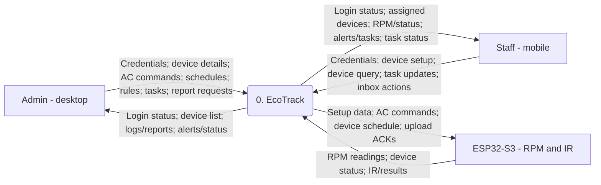
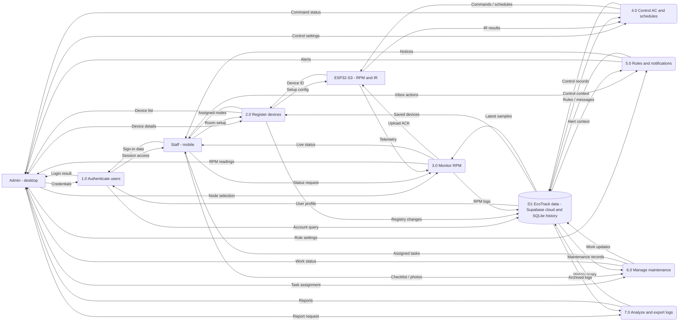

# EcoTrack data flow diagrams

Concise logical DFDs with desktop-only administrator and mobile staff; D1 groups related cloud and local records.

## Level 0 - context

<!-- mermaid:id=level_0 -->

## Level 1 - decomposition

<!-- mermaid:id=level_1 -->

